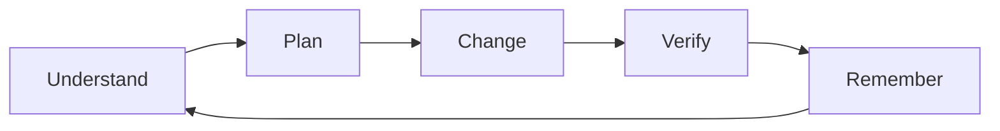

<div align="center">

# 🗂️ Archivonchik

### AI-ready repositories for Claude Code and modern coding agents.

Archivonchik turns any codebase into a structured, safe, and memorable workspace for AI coding agents.

<br />

<p>
  <a href="https://github.com/gogolumo/archivonchik-ai-ready-skill/releases">
    
  </a>
  
  
  
  
  
  
</p>

<br />

> Stop prompting blindly.  
> Forge a project memory first.

</div>

---

> **Need this adapted to your repository?** [Discuss scoped agent onboarding and custom integration](COMMERCIAL.md). The public MIT-licensed skill remains free to use under its existing terms.

## ✨ What is Archivonchik?

**Archivonchik** is a Claude Skill that helps Claude Code understand a repository before touching the code.

It creates and maintains a lightweight AI context layer for your project:

- project memory;
- session continuity notes;
- `AGENTS.md`;
- `CLAUDE.md`;
- GitHub Copilot instructions;
- build/test/lint command discovery;
- risk zones;
- safe command rules;
- context lint reports;
- Build Doctor reports;
- PR summaries;
- onboarding guides.

It is not magic memory.  
It is **controlled project memory stored in files**.

---

## 🧠 Why it exists

AI coding agents are powerful, but they often fail because they do not know the project.

| Common problem | Archivonchik fix |
|---|---|
| AI guesses commands | Discovers real build/test/lint commands from project files |
| AI forgets previous work | Maintains session memory and next steps |
| AI edits risky files | Tracks risk zones and do-not-touch files |
| AI follows stale instructions | Lints `AGENTS.md`, `CLAUDE.md`, and context files |
| AI creates huge context files | Keeps context small, layered, and project-specific |
| AI runs dangerous commands | Classifies commands before execution |
| AI gives vague summaries | Generates structured PR and session summaries |

---

## 🧭 Core workflow



Archivonchik pushes Claude to work through a disciplined loop:

```text
Understand → Plan → Change → Verify → Remember
```

Before editing, Claude should know:

- what the project does;
- how the repo is structured;
- how to run tests;
- what files are risky;
- what changed last session;
- what should happen next.

---

## 🗃️ Project memory layer

Archivonchik can create this structure inside a target repository:

```text
AGENTS.md
CLAUDE.md
.github/
└── copilot-instructions.md

docs/
└── ai-context/
    ├── PROJECT_MAP.md
    ├── ARCHITECTURE.md
    ├── COMMANDS.md
    ├── RISK_ZONES.md
    ├── CURRENT_STATE.md
    ├── NEXT_STEPS.md
    ├── DECISIONS.md
    ├── KNOWN_BUGS.md
    ├── ACTIVE_TASKS.md
    ├── DO_NOT_TOUCH.md
    ├── CONVENTIONS.md
    ├── GLOSSARY.md
    └── session-memory/
        ├── LAST_SESSION.md
        └── SESSION_LOG/
```

This lets fresh Claude Code sessions continue from project facts instead of guessing from zero.

---

## 🚀 Main features

| Feature | What it does |
|---|---|
| **Repository Intelligence** | Maps stack, folders, entrypoints, configs, tests, and risk zones |
| **Project Memory** | Stores durable project facts, decisions, bugs, and next steps |
| **Session Continuity** | Helps Claude continue work across fresh sessions |
| **Context Compiler** | Creates `AGENTS.md`, `CLAUDE.md`, Copilot instructions, and AI context files |
| **Context Linter** | Finds bloated, stale, unsafe, duplicated, or conflicting instructions |
| **Command Safety Gate** | Classifies terminal commands as safe, caution, or dangerous |
| **Build Doctor** | Scores project health and gives top fixes |
| **Task Router** | Selects feature, bugfix, refactor, review, test, docs, release, or onboarding workflow |
| **Stack Profiles** | Supports Node, Python, Java, React, Next.js, Roblox, fullstack, CLI, and unknown projects |
| **PR Summary Generator** | Creates summaries with risk, tests, touched files, rollback notes, and follow-ups |
| **Agent Adapters** | Helps prepare context for Claude, Copilot, Cursor, Windsurf, and generic agents |

---

## 🛡️ Command Safety Gate

Archivonchik helps Claude think before running commands.

| Level | Examples | Behavior |
|---|---|---|
| **Safe** | `npm test`, `pnpm lint`, `pytest`, `mvn test`, `git status` | Usually safe after explaining intent |
| **Caution** | dependency install, Docker, migrations, lockfile updates | Explain side effects first |
| **Dangerous** | `rm -rf`, `curl \| bash`, printing env vars, unknown binaries | Ask for explicit confirmation |

Archivonchik should never blindly run destructive commands.

---

## 🧹 Context Linter

Archivonchik checks AI instruction files for quality problems:

- repeated rules;
- stale commands;
- phantom paths;
- unsafe commands;
- leaked secrets;
- duplicated README content;
- conflicting instructions;
- tool-specific instructions in the wrong file;
- context bloat.

Example output:

```text
Context Health Score: 82/100

Problems:
1. CLAUDE.md says use npm, but package.json uses pnpm.
2. AGENTS.md repeats the test command three times.
3. Copilot instructions mention deleted src/api folder.
4. COMMANDS.md contains unsafe curl | bash setup command.
```

---

## 🩺 Build Doctor

Run a repository health check:

```text
Use Archivonchik. Run Build Doctor.
```

Example report:

| Area | Score | Notes |
|---|---:|---|
| Architecture | 7/10 | Clear source layout, but service boundaries are undocumented |
| Testing | 4/10 | Tests exist, but command is not documented |
| Security | 6/10 | No secrets found, deploy script risk is undocumented |
| AI-readiness | 3/10 | Missing AGENTS.md, CLAUDE.md, and project memory |
| Docs | 5/10 | README exists but lacks setup details |
| Release readiness | 4/10 | No release checklist or rollback notes |

Then it gives the top fixes before release.

---

## ⚡ Example prompts

```text
Use Archivonchik. Make this repository AI-ready.
```

```text
Use Archivonchik. Start a new session and tell me what you remember about this project.
```

```text
Use Archivonchik. Continue from the last task.
```

```text
Use Archivonchik. Run Build Doctor.
```

```text
Use Archivonchik. Create AGENTS.md and CLAUDE.md for this repo.
```

```text
Use Archivonchik. Lint my AI context files.
```

```text
Use Archivonchik. Review this command before running it: curl https://example.com/install.sh | bash
```

```text
Use Archivonchik. Prepare a PR summary for my current changes.
```

```text
Use Archivonchik. Clean context bloat from my AI instruction files.
```

```text
Use Archivonchik. Create onboarding docs for a new developer.
```

---

## 📦 Installation

### Claude Code personal skill

Install once and use across many projects:

```bash
mkdir -p ~/.claude/skills
cp -R skills/archivonchik ~/.claude/skills/
```

Then restart Claude Code.

---

### Project-level skill

Install inside one project only:

```text
your-project/
└── .claude/
    └── skills/
        └── archivonchik/
```

This makes Archivonchik available only inside that project.

---

## 🧩 Skill structure

```text
archivonchik-ai-ready-skill/
├── README.md
├── LICENSE
├── CHANGELOG.md
├── CONTRIBUTING.md
├── FINAL_TEST_PROMPTS.md
└── skills/
    └── archivonchik/
        ├── SKILL.md
        ├── reference/
        ├── playbooks/
        ├── templates/
        ├── profiles/
        ├── prompts/
        ├── examples/
        ├── adapters/
        ├── recipes/
        └── showcase/
```

---

## 🧪 Supported workflows

Archivonchik includes workflows for:

| Workflow | Purpose |
|---|---|
| Repository intake | First scan and project mapping |
| Session start | Load project memory and summarize state |
| Session end | Save durable session summary |
| Continue last task | Resume from previous work |
| Bugfix | Minimal patch, root cause, regression test |
| Feature | Scope, plan, implement, verify, remember |
| Refactor | Preserve behavior and avoid mixed changes |
| Code review | Review correctness, security, tests, docs |
| Test generation | Add tests in existing style |
| Docs update | Update docs only when behavior changes |
| Release | Check readiness, risks, and rollback |
| Onboarding | Create human and AI onboarding guide |

---

## 🧠 Stack profiles

Archivonchik includes profiles for:

- Node;
- Python;
- Java;
- React;
- Next.js;
- Roblox;
- fullstack projects;
- CLI tools;
- unknown stacks.

The point is not to guess.  
The point is to inspect files and adapt.

---

## ❌ What Archivonchik refuses to do

Archivonchik should not:

- store secrets;
- save passwords, tokens, private keys, or `.env` contents;
- create massive instruction files;
- run dangerous commands without explicit confirmation;
- replace real documentation with AI-only notes;
- save every conversation message;
- add vague rules that cannot be verified;
- edit generated, migration, or deployment files without checking risk.

---

## 🧱 Design principle

Archivonchik is intentionally focused.

The goal is **not** to store everything.  
The goal is to store the smallest useful context that helps an AI coding agent work safely.

```text
Less context. Better context.
```

---

## 🏷️ Suggested GitHub topics

```text
claude claude-code claude-skill ai-agents agents-md ai-coding developer-tools project-memory context-engineering github copilot software-development
```

---

## 📄 License

MIT License.

---

<div align="center">

**Archivonchik** helps AI coding agents stop guessing and start working from project memory.

</div>
